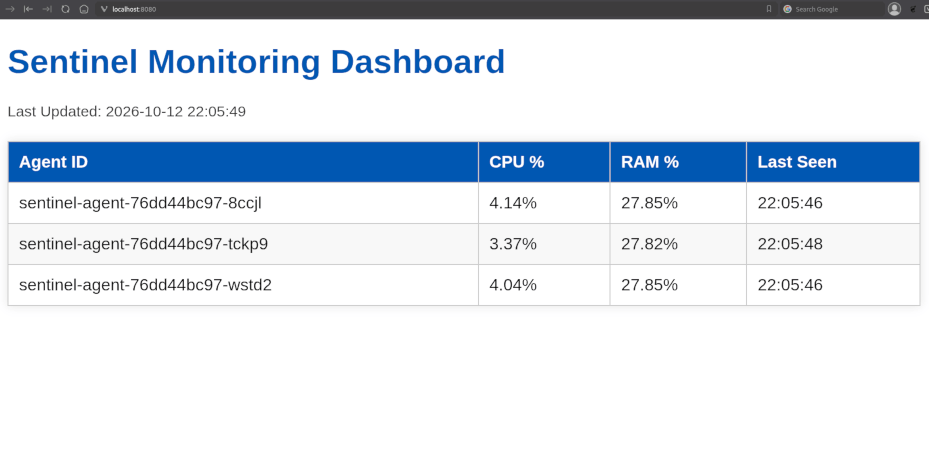
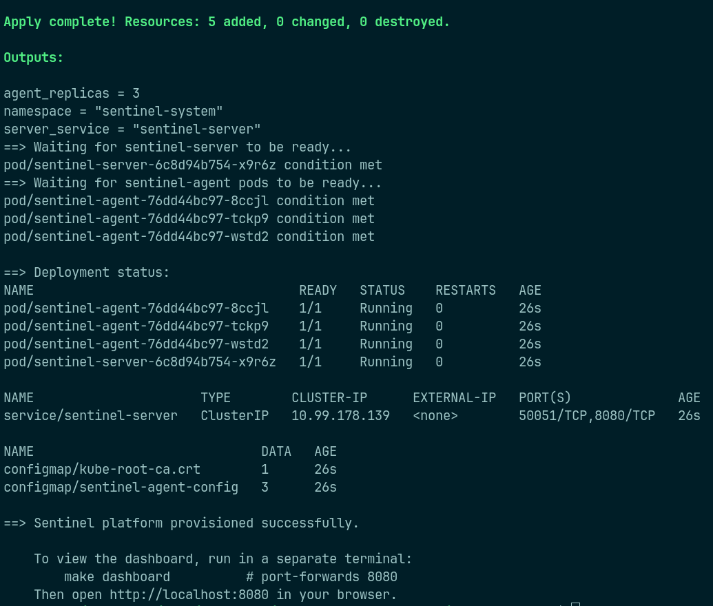

# Sentinel Platform Infrastructure `sentinel-infra`

[](https://terraform.io)
[](https://kubernetes.io)
[](LICENSE)

Terraform + Kubernetes infrastructure for [Sentinel](https://github.com/nradojcic/sentinel), a distributed Go system monitor. This repository provisions the full platform: namespace, server deployment with gRPC + HTTP services, three agent replicas with startup ordering, and configuration injection via ConfigMap - all from a single `make bootstrap`.

## Why this exists

The [Sentinel](https://github.com/nradojcic/sentinel) repo demonstrates a distributed Go application, but running `docker-compose up` doesn't exercise the operational realities of a Kubernetes environment: probe semantics, startup ordering between dependent services, config injection without baking values into images, and declarative resource management.

This repository provisions Sentinel on Kubernetes using Terraform so the deployment path is reproducible, auditable, and separable from the application code. The same modules that run against a local Minikube cluster are structured to target a managed cluster (EKS, GKE) by swapping the provider configuration.

## Visual Showcase

### Sentinel Dashboard (deployed via this infrastructure)


_Three agent pods reporting live CPU/RAM metrics to the server dashboard._

### Deployment Status


_All four pods running with zero restarts after a clean bootstrap._

## Architecture

```txt
                    ┌────────────────────────────────────────────┐
                    │  Kubernetes (Minikube)                     │
                    │  namespace: sentinel-system                │
                    │                                            │
  ┌───────────┐     │   ┌──────────────────────────────┐         │
  │ Terraform │───▶│   │  sentinel-agent (x3)         │         │
  │  modules  │     │   │  ────────────────            │         │
  └───────────┘     │   │  env ← ConfigMap             │         │
                    │   └──────────────┬───────────────┘         │
                    │                  │                         │
                    │                  │  gRPC stream :50051     │
                    │                  ▼                         │
                    │   ┌──────────────────────────────┐         │
                    │   │  sentinel-server (x1)        │         │
                    │   │  Service ClusterIP           │         │
                    │   │    :50051 (gRPC)             │         │
                    │   │    :8080  (HTTP dashboard)   │         │
                    │   └──────────────────────────────┘         │
                    └────────────────────────────────────────────┘
```

## What this deploys

- Kubernetes namespace (`sentinel-system`) with labels for ownership tracking
- `sentinel-server` Deployment (1 replica) with TCP readiness/liveness probes on the gRPC port
- `sentinel-server` ClusterIP Service exposing both gRPC (`50051`) and HTTP (`8080`)
- `sentinel-agent` Deployment (3 replicas) with an init container that waits for the server before starting
- `sentinel-agent-config` ConfigMap injecting server address, poll interval, and log level via `env_from`
- Reusable Terraform modules (`sentinel_server`, `sentinel_agent`) with variable validation and explicit image pull policy

## Technical Highlights

- **Init container for startup ordering**: Kubernetes has no `depends_on` for pods, so agents wait on the server's gRPC listener via a `busybox` init container that polls with `nc`. This eliminates cold-start crash loops without complicating the app code.
- **TCP probes for gRPC**: The server's primary protocol is gRPC, not HTTP. TCP probes correctly verify the listener is up without assuming an HTTP stack.
- **Explicit `image_pull_policy`**: `IfNotPresent` supports both locally-built Minikube images and registry-pushed images without code changes. Default `Always` would fail in Minikube; `Never` would fail in production.
- **12-factor config injection**: Agent configuration flows through a ConfigMap → `env_from` → process environment, with no credentials or environment-specific values baked into the container image.
- **Module boundaries mirror runtime concerns**: `sentinel_server` and `sentinel_agent` are separate modules because they have different scaling, probe, and config requirements. Adding an `environments/eks/` later is a provider swap, not a rewrite.

## Getting Started

### Prerequisites

- Terraform >= 1.5
- Minikube (Docker driver)
- kubectl
- Docker
- The [Sentinel](https://github.com/nradojcic/sentinel) repo checked out locally (or images already present in Minikube)

### Installation

    git clone https://github.com/nradojcic/sentinel-infra.git
    cd sentinel-infra

### Quick Start

Bootstrap the entire platform from a clean Minikube:

    make bootstrap

This will:
1. Start Minikube if it isn't running
2. Build `sentinel-server:dev` and `sentinel-agent:dev` into Minikube's Docker daemon
3. Run `terraform apply` to create the namespace, deployments, service, and configmap
4. Wait for all pods to become ready
5. Print the deployment status

Override the Sentinel source path if your checkout is elsewhere:

    SENTINEL_SRC=/path/to/sentinel make bootstrap

## Verifying the Deployment

    make status

    make dashboard

Then open [http://localhost:8080](http://localhost:8080) in your browser.

## Makefile Targets

| Target | Description |
|---|---|
| `make bootstrap` | Full end-to-end setup (Minikube + images + terraform apply) |
| `make init` | `terraform init` |
| `make plan` | `terraform plan` |
| `make apply` | `terraform apply` |
| `make destroy` | `terraform destroy` |
| `make dashboard` | Port-forward the Sentinel dashboard on `:8080` (blocking) |
| `make status` | Show pods, services, and configmaps in `sentinel-system` |
| `make logs-agent` | Tail agent pod logs |
| `make logs-server` | Tail server pod logs |
| `make fmt` | `terraform fmt -recursive` |
| `make validate` | `terraform validate` |
| `make lint` | `tflint` (if installed) |

## Validation

Before committing, all configurations are checked locally:

```bash
make fmt        # terraform fmt -recursive = canonical HCL formatting
make validate   # terraform validate = syntax, type, and reference checks
make lint       # tflint --recursive (optional, skipped if not installed)
```

## Configuration

Variables are located in `environments/dev/variables.tf` and can be overridden via `terraform.tfvars`. See `terraform.tfvars.example` for the full set.

Key variables:
- `namespace` - Kubernetes namespace (default `sentinel-system`)
- `server_image` / `agent_image` - Container image references
- `server_port` - gRPC port (default `50051`)
- `agent_replicas` - Number of agent pods (default `3`, validated 1–10)

## Tech Stack

- **Terraform** - declarative infrastructure provisioning
- **Kubernetes provider** - resources deployed against Minikube
- **Docker** - image builds into Minikube's daemon
- **Bash** - one-command bootstrap script
- **Make** - target-based workflow

## Cleanup

- Destroy the Terraform-managed resources: `make destroy`
- Remove Minikube entirely: `minikube delete`

## Full Bootstrap Output

<details>
<summary>Click to see the full output from a clean <code>minikube delete && make bootstrap</code> run</summary>

```txt
~/Documents/Code/Terraform/sentinel-infra$ minikube delete
🔥  Deleting "minikube" in docker ...
🔥  Deleting container "minikube" ...
🔥  Removing /home/it/.minikube/machines/minikube ...
💀  Removed all traces of the "minikube" cluster.

~/Documents/Code/Terraform/sentinel-infra$ make bootstrap 
./scripts/bootstrap.sh
==> Checking Minikube status...
    Starting Minikube...
😄  minikube v1.38.1 on Fedora 44
✨  Using the docker driver based on user configuration
❗  Starting v1.39.0, minikube will default to "containerd" container runtime. See #21973 for more info.
📌  Using Docker driver with root privileges
👍  Starting "minikube" primary control-plane node in "minikube" cluster
🚜  Pulling base image v0.0.50 ...
🔥  Creating docker container (CPUs=2, Memory=7900MB) ...
🐳  Preparing Kubernetes v1.35.1 on Docker 29.2.1 ...
🔗  Configuring bridge CNI (Container Networking Interface) ...
🔎  Verifying Kubernetes components...
    ▪ Using image gcr.io/k8s-minikube/storage-provisioner:v5
🌟  Enabled addons: storage-provisioner, default-storageclass

❗  /usr/local/bin/kubectl is version 1.33.2, which may have incompatibilities with Kubernetes 1.35.1.
    ▪ Want kubectl v1.35.1? Try 'minikube kubectl -- get pods -A'
🏄  Done! kubectl is now configured to use "minikube" cluster and "default" namespace by default
==> Configuring shell to use Minikube's Docker daemon...
==> Building Sentinel images from /home/it/Documents/Code/go-src/2026-02-distributed-comm-syst/sentinel...
[+] Building 25.7s (16/16) FINISHED                                                                                                                           docker:default
 => [internal] load build definition from Dockerfile.server                                                                                                             0.1s
 => => transferring dockerfile: 957B                                                                                                                                    0.0s
 => [internal] load metadata for docker.io/library/alpine:latest                                                                                                        1.2s
 => [internal] load metadata for docker.io/library/golang:1.25.6-alpine                                                                                                 1.2s
 => [internal] load .dockerignore                                                                                                                                       0.1s
 => => transferring context: 2B                                                                                                                                         0.0s
 => [stage-1 1/4] FROM docker.io/library/alpine:latest@sha256:294b683cb724975bec92580e1e685676bd4b50bda910ddb8c51d4cabeaec77e6                                          2.7s
 => => resolve docker.io/library/alpine:latest@sha256:294b683cb724975bec92580e1e685676bd4b50bda910ddb8c51d4cabeaec77e6                                                  0.2s
 => => sha256:294b683cb724975bec92580e1e685676bd4b50bda910ddb8c51d4cabeaec77e6 9.22kB / 9.22kB                                                                          0.0s
 => => sha256:d56c381f961d307a21b3ca004cf1e3910f106644aefb1f43e654c8a56c4fd395 1.02kB / 1.02kB                                                                          0.0s
 => => sha256:320994c3b997e2ec6433f717f153e108023c5bec8fefa8d76b83451d16d05ea8 611B / 611B                                                                              0.0s
 => => sha256:e2de96513ba9eb53b431787ec8a65cdde380ac4772a3e4c4b714dcfde2a102b5 3.85MB / 3.85MB                                                                          2.2s
 => => extracting sha256:e2de96513ba9eb53b431787ec8a65cdde380ac4772a3e4c4b714dcfde2a102b5                                                                               0.1s
 => [internal] load build context                                                                                                                                       0.4s
 => => transferring context: 20.96MB                                                                                                                                    0.3s
 => [builder 1/6] FROM docker.io/library/golang:1.25.6-alpine@sha256:98e6cffc31ccc44c7c15d83df1d69891efee8115a5bb7ede2bf30a38af3e3c92                                   9.6s
 => => resolve docker.io/library/golang:1.25.6-alpine@sha256:98e6cffc31ccc44c7c15d83df1d69891efee8115a5bb7ede2bf30a38af3e3c92                                           0.1s
 => => sha256:32eb1b17fb288f55faaf325ed5f3188968c4887057459fbe87024092539077bf 2.19kB / 2.19kB                                                                          0.0s
 => => sha256:20c503e035cd5c1ea67986d21ed1fb2f4305f801555c52f9f16ce0f0f5cf2e16 60.15MB / 60.15MB                                                                        5.9s
 => => sha256:98e6cffc31ccc44c7c15d83df1d69891efee8115a5bb7ede2bf30a38af3e3c92 10.29kB / 10.29kB                                                                        0.0s
 => => sha256:72613572613050e1c6da0a585daf8f7d4174eb17a0c9c3a539633d677e3e2979 1.92kB / 1.92kB                                                                          0.0s
 => => sha256:c12843b674336be62defd21ad5cc5ec625ab7ab140b46a2a49d11e46ad25d08a 296.08kB / 296.08kB                                                                      0.5s
 => => sha256:589002ba0eaed121a1dbf42f6648f29e5be55d5c8a6ee0f8eaa0285cc21ac153 3.86MB / 3.86MB                                                                          1.9s
 => => sha256:5ad936b911f013e0d5e8e1872c1005ff3700a9d10b1edf23acfe69ebf39758ce 125B / 125B                                                                              0.7s
 => => sha256:4f4fb700ef54461cfa02571ae0db9a0dc1e0cdb5577484a6d75e68dc38e8acc1 32B / 32B                                                                                0.9s
 => => extracting sha256:589002ba0eaed121a1dbf42f6648f29e5be55d5c8a6ee0f8eaa0285cc21ac153                                                                               0.1s
 => => extracting sha256:c12843b674336be62defd21ad5cc5ec625ab7ab140b46a2a49d11e46ad25d08a                                                                               0.0s
 => => extracting sha256:20c503e035cd5c1ea67986d21ed1fb2f4305f801555c52f9f16ce0f0f5cf2e16                                                                               2.9s
 => => extracting sha256:5ad936b911f013e0d5e8e1872c1005ff3700a9d10b1edf23acfe69ebf39758ce                                                                               0.0s
 => => extracting sha256:4f4fb700ef54461cfa02571ae0db9a0dc1e0cdb5577484a6d75e68dc38e8acc1                                                                               0.0s
 => [builder 2/6] WORKDIR /app                                                                                                                                          0.3s
 => [builder 3/6] COPY go.mod go.sum ./                                                                                                                                 0.1s
 => [builder 4/6] RUN go mod download                                                                                                                                   4.8s
 => [builder 5/6] COPY . .                                                                                                                                              0.2s
 => [builder 6/6] RUN go build -o /sentinel main.go                                                                                                                     8.2s
 => [stage-1 2/4] COPY --from=builder /sentinel /sentinel                                                                                                               0.1s
 => [stage-1 3/4] COPY .sentinel.yaml .sentinel.yaml                                                                                                                    0.1s
 => [stage-1 4/4] COPY web ./web                                                                                                                                        0.1s
 => exporting to image                                                                                                                                                  0.2s
 => => exporting layers                                                                                                                                                 0.2s
 => => writing image sha256:1261abaac5ce86939485d341e82d780f956504b3ed5db286c99cf23460f18871                                                                            0.0s
 => => naming to docker.io/library/sentinel-server:dev                                                                                                                  0.0s
[+] Building 0.6s (15/15) FINISHED                                                                                                                            docker:default
 => [internal] load build definition from Dockerfile.agent                                                                                                              0.0s
 => => transferring dockerfile: 840B                                                                                                                                    0.0s
 => [internal] load metadata for docker.io/library/alpine:latest                                                                                                        0.2s
 => [internal] load metadata for docker.io/library/golang:1.25.6-alpine                                                                                                 0.2s
 => [internal] load .dockerignore                                                                                                                                       0.0s
 => => transferring context: 2B                                                                                                                                         0.0s
 => [builder 1/6] FROM docker.io/library/golang:1.25.6-alpine@sha256:98e6cffc31ccc44c7c15d83df1d69891efee8115a5bb7ede2bf30a38af3e3c92                                   0.0s
 => [internal] load build context                                                                                                                                       0.1s
 => => transferring context: 43.19kB                                                                                                                                    0.0s
 => [stage-1 1/3] FROM docker.io/library/alpine:latest@sha256:294b683cb724975bec92580e1e685676bd4b50bda910ddb8c51d4cabeaec77e6                                          0.0s
 => CACHED [builder 2/6] WORKDIR /app                                                                                                                                   0.0s
 => CACHED [builder 3/6] COPY go.mod go.sum ./                                                                                                                          0.0s
 => CACHED [builder 4/6] RUN go mod download                                                                                                                            0.0s
 => CACHED [builder 5/6] COPY . .                                                                                                                                       0.0s
 => CACHED [builder 6/6] RUN go build -o /sentinel main.go                                                                                                              0.0s
 => CACHED [stage-1 2/3] COPY --from=builder /sentinel /sentinel                                                                                                        0.0s
 => CACHED [stage-1 3/3] COPY .sentinel.yaml .sentinel.yaml                                                                                                             0.0s
 => exporting to image                                                                                                                                                  0.0s
 => => exporting layers                                                                                                                                                 0.0s
 => => writing image sha256:fcac3ee60e566df7cafbf63b6b8cdd3313ed07a7e99de7accee489bad7f4b03b                                                                            0.0s
 => => naming to docker.io/library/sentinel-agent:dev                                                                                                                   0.0s
==> Running terraform init...
Initializing the backend...

Upgrading modules...
- sentinel_server in ../../modules/sentinel_server
- sentinel_agent in ../../modules/sentinel_agent

Initializing provider plugins...
- Finding hashicorp/kubernetes versions matching "~> 3.2"...
- Using previously-installed hashicorp/kubernetes v3.3.0

Terraform has been successfully initialized!

You may now begin working with Terraform. Try running "terraform plan" to see
any changes that are required for your infrastructure. All Terraform commands
should now work.

If you ever set or change modules or backend configuration for Terraform,
rerun this command to reinitialize your working directory. If you forget, other
commands will detect it and remind you to do so if necessary.
==> Applying Terraform...
kubernetes_namespace_v1.sentinel: Refreshing state... [id=sentinel-system]
module.sentinel_server.kubernetes_service_v1.server: Refreshing state... [id=sentinel-system/sentinel-server]
module.sentinel_server.kubernetes_deployment_v1.server: Refreshing state... [id=sentinel-system/sentinel-server]
module.sentinel_agent.kubernetes_config_map_v1.agent_config: Refreshing state... [id=sentinel-system/sentinel-agent-config]
module.sentinel_agent.kubernetes_deployment_v1.agent: Refreshing state... [id=sentinel-system/sentinel-agent]

Note: Objects have changed outside of Terraform

Terraform detected the following changes made outside of Terraform since the last "terraform apply" which may have affected this plan:

  # kubernetes_namespace_v1.sentinel has been deleted
  - resource "kubernetes_namespace_v1" "sentinel" {
        id                               = "sentinel-system"
        # (1 unchanged attribute hidden)

      - metadata {
          - name             = "sentinel-system" -> null
            # (4 unchanged attributes hidden)
        }
    }

  # module.sentinel_agent.kubernetes_config_map_v1.agent_config has been deleted
  - resource "kubernetes_config_map_v1" "agent_config" {
        id          = "sentinel-system/sentinel-agent-config"
        # (3 unchanged attributes hidden)

      - metadata {
          - name             = "sentinel-agent-config" -> null
            # (7 unchanged attributes hidden)
        }
    }

  # module.sentinel_agent.kubernetes_deployment_v1.agent has been deleted
  - resource "kubernetes_deployment_v1" "agent" {
        id               = "sentinel-system/sentinel-agent"
        # (1 unchanged attribute hidden)

      - metadata {
          - name             = "sentinel-agent" -> null
            # (7 unchanged attributes hidden)
        }

        # (1 unchanged block hidden)
    }

  # module.sentinel_server.kubernetes_deployment_v1.server has been deleted
  - resource "kubernetes_deployment_v1" "server" {
        id               = "sentinel-system/sentinel-server"
        # (1 unchanged attribute hidden)

      - metadata {
          - name             = "sentinel-server" -> null
            # (7 unchanged attributes hidden)
        }

        # (1 unchanged block hidden)
    }

  # module.sentinel_server.kubernetes_service_v1.server has been deleted
  - resource "kubernetes_service_v1" "server" {
        id                     = "sentinel-system/sentinel-server"
        # (2 unchanged attributes hidden)

      - metadata {
          - name             = "sentinel-server" -> null
            # (7 unchanged attributes hidden)
        }

        # (1 unchanged block hidden)
    }


Unless you have made equivalent changes to your configuration, or ignored the relevant attributes using ignore_changes, the following plan may include actions to undo or
respond to these changes.

────────────────────────────────────────────────────────────────────────────────────────────────────────────────────────────────────────────────────────────────────────────

Terraform used the selected providers to generate the following execution plan. Resource actions are indicated with the following symbols:
  + create

Terraform will perform the following actions:

  # kubernetes_namespace_v1.sentinel will be created
  + resource "kubernetes_namespace_v1" "sentinel" {
      + id                               = (known after apply)
      + wait_for_default_service_account = false

      + metadata {
          + generation       = (known after apply)
          + labels           = {
              + "app.kubernetes.io/managed-by" = "terraform"
              + "app.kubernetes.io/part-of"    = "sentinel"
            }
          + name             = "sentinel-system"
          + resource_version = (known after apply)
          + uid              = (known after apply)
        }
    }

  # module.sentinel_agent.kubernetes_config_map_v1.agent_config will be created
  + resource "kubernetes_config_map_v1" "agent_config" {
      + data = {
          + "SENTINEL_LOG_LEVEL"     = "info"
          + "SENTINEL_POLL_INTERVAL" = "5"
          + "SENTINEL_SERVER_TARGET" = "sentinel-server.sentinel-system.svc.cluster.local:50051"
        }
      + id   = (known after apply)

      + metadata {
          + generation       = (known after apply)
          + name             = "sentinel-agent-config"
          + namespace        = "sentinel-system"
          + resource_version = (known after apply)
          + uid              = (known after apply)
        }
    }

  # module.sentinel_agent.kubernetes_deployment_v1.agent will be created
  + resource "kubernetes_deployment_v1" "agent" {
      + id               = (known after apply)
      + wait_for_rollout = true

      + metadata {
          + generation       = (known after apply)
          + labels           = {
              + "app" = "sentinel-agent"
            }
          + name             = "sentinel-agent"
          + namespace        = "sentinel-system"
          + resource_version = (known after apply)
          + uid              = (known after apply)
        }

      + spec {
          + min_ready_seconds         = 0
          + paused                    = false
          + progress_deadline_seconds = 600
          + replicas                  = "3"
          + revision_history_limit    = 10

          + selector {
              + match_labels = {
                  + "app" = "sentinel-agent"
                }
            }

          + strategy (known after apply)

          + template {
              + metadata {
                  + generation       = (known after apply)
                  + labels           = {
                      + "app" = "sentinel-agent"
                    }
                  + name             = (known after apply)
                  + resource_version = (known after apply)
                  + uid              = (known after apply)
                }
              + spec {
                  + automount_service_account_token  = true
                  + dns_policy                       = "ClusterFirst"
                  + enable_service_links             = true
                  + host_ipc                         = false
                  + host_network                     = false
                  + host_pid                         = false
                  + hostname                         = (known after apply)
                  + node_name                        = (known after apply)
                  + restart_policy                   = "Always"
                  + scheduler_name                   = (known after apply)
                  + service_account_name             = (known after apply)
                  + share_process_namespace          = false
                  + termination_grace_period_seconds = 30

                  + container {
                      + args                       = [
                          + "--agent-id=$(POD_NAME)",
                          + "--server-addr=sentinel-server.sentinel-system.svc.cluster.local:50051",
                          + "--interval=5",
                        ]
                      + command                    = [
                          + "/sentinel",
                          + "agent",
                        ]
                      + image                      = "sentinel-agent:dev"
                      + image_pull_policy          = "IfNotPresent"
                      + name                       = "agent"
                      + restart_policy             = (known after apply)
                      + stdin                      = false
                      + stdin_once                 = false
                      + termination_message_path   = "/dev/termination-log"
                      + termination_message_policy = (known after apply)
                      + tty                        = false

                      + env {
                          + name = "POD_NAME"

                          + value_from {
                              + field_ref {
                                  + api_version = "v1"
                                  + field_path  = "metadata.name"
                                }
                            }
                        }

                      + env_from {
                          + config_map_ref {
                              + name = "sentinel-agent-config"
                            }
                        }

                      + resources {
                          + limits   = {
                              + "cpu"    = "200m"
                              + "memory" = "128Mi"
                            }
                          + requests = {
                              + "cpu"    = "50m"
                              + "memory" = "64Mi"
                            }
                        }
                    }

                  + image_pull_secrets (known after apply)

                  + init_container {
                      + command                    = [
                          + "sh",
                          + "-c",
                          + "until nc -z sentinel-server 50051; do echo waiting for sentinel-server; sleep 2; done",
                        ]
                      + image                      = "busybox:1.36"
                      + image_pull_policy          = (known after apply)
                      + name                       = "wait-for-server"
                      + restart_policy             = (known after apply)
                      + stdin                      = false
                      + stdin_once                 = false
                      + termination_message_path   = "/dev/termination-log"
                      + termination_message_policy = (known after apply)
                      + tty                        = false

                      + resources (known after apply)
                    }

                  + readiness_gate (known after apply)
                }
            }
        }
    }

  # module.sentinel_server.kubernetes_deployment_v1.server will be created
  + resource "kubernetes_deployment_v1" "server" {
      + id               = (known after apply)
      + wait_for_rollout = true

      + metadata {
          + generation       = (known after apply)
          + labels           = {
              + "app" = "sentinel-server"
            }
          + name             = "sentinel-server"
          + namespace        = "sentinel-system"
          + resource_version = (known after apply)
          + uid              = (known after apply)
        }

      + spec {
          + min_ready_seconds         = 0
          + paused                    = false
          + progress_deadline_seconds = 600
          + replicas                  = "1"
          + revision_history_limit    = 10

          + selector {
              + match_labels = {
                  + "app" = "sentinel-server"
                }
            }

          + strategy (known after apply)

          + template {
              + metadata {
                  + generation       = (known after apply)
                  + labels           = {
                      + "app" = "sentinel-server"
                    }
                  + name             = (known after apply)
                  + resource_version = (known after apply)
                  + uid              = (known after apply)
                }
              + spec {
                  + automount_service_account_token  = true
                  + dns_policy                       = "ClusterFirst"
                  + enable_service_links             = true
                  + host_ipc                         = false
                  + host_network                     = false
                  + host_pid                         = false
                  + hostname                         = (known after apply)
                  + node_name                        = (known after apply)
                  + restart_policy                   = "Always"
                  + scheduler_name                   = (known after apply)
                  + service_account_name             = (known after apply)
                  + share_process_namespace          = false
                  + termination_grace_period_seconds = 30

                  + container {
                      + image                      = "sentinel-server:dev"
                      + image_pull_policy          = "IfNotPresent"
                      + name                       = "server"
                      + restart_policy             = (known after apply)
                      + stdin                      = false
                      + stdin_once                 = false
                      + termination_message_path   = "/dev/termination-log"
                      + termination_message_policy = (known after apply)
                      + tty                        = false

                      + liveness_probe {
                          + failure_threshold     = 3
                          + initial_delay_seconds = 5
                          + period_seconds        = 10
                          + success_threshold     = 1
                          + timeout_seconds       = 1

                          + tcp_socket {
                              + port = "50051"
                            }
                        }

                      + port {
                          + container_port = 50051
                          + name           = "grpc"
                          + protocol       = "TCP"
                        }
                      + port {
                          + container_port = 8080
                          + name           = "http"
                          + protocol       = "TCP"
                        }

                      + readiness_probe {
                          + failure_threshold     = 3
                          + initial_delay_seconds = 2
                          + period_seconds        = 5
                          + success_threshold     = 1
                          + timeout_seconds       = 1

                          + tcp_socket {
                              + port = "50051"
                            }
                        }

                      + resources {
                          + limits   = {
                              + "cpu"    = "500m"
                              + "memory" = "256Mi"
                            }
                          + requests = {
                              + "cpu"    = "100m"
                              + "memory" = "128Mi"
                            }
                        }
                    }

                  + image_pull_secrets (known after apply)

                  + readiness_gate (known after apply)
                }
            }
        }
    }

  # module.sentinel_server.kubernetes_service_v1.server will be created
  + resource "kubernetes_service_v1" "server" {
      + id                     = (known after apply)
      + status                 = (known after apply)
      + wait_for_load_balancer = true

      + metadata {
          + generation       = (known after apply)
          + name             = "sentinel-server"
          + namespace        = "sentinel-system"
          + resource_version = (known after apply)
          + uid              = (known after apply)
        }

      + spec {
          + allocate_load_balancer_node_ports = true
          + cluster_ip                        = (known after apply)
          + cluster_ips                       = (known after apply)
          + external_traffic_policy           = (known after apply)
          + health_check_node_port            = (known after apply)
          + internal_traffic_policy           = (known after apply)
          + ip_families                       = (known after apply)
          + ip_family_policy                  = (known after apply)
          + publish_not_ready_addresses       = false
          + selector                          = {
              + "app" = "sentinel-server"
            }
          + session_affinity                  = "None"
          + type                              = "ClusterIP"

          + port {
              + name        = "grpc"
              + node_port   = (known after apply)
              + port        = 50051
              + protocol    = "TCP"
              + target_port = "50051"
            }
          + port {
              + name        = "http"
              + node_port   = (known after apply)
              + port        = 8080
              + protocol    = "TCP"
              + target_port = "8080"
            }

          + session_affinity_config (known after apply)
        }
    }

Plan: 5 to add, 0 to change, 0 to destroy.
kubernetes_namespace_v1.sentinel: Creating...
kubernetes_namespace_v1.sentinel: Creation complete after 0s [id=sentinel-system]
module.sentinel_server.kubernetes_service_v1.server: Creating...
module.sentinel_server.kubernetes_deployment_v1.server: Creating...
module.sentinel_server.kubernetes_service_v1.server: Creation complete after 0s [id=sentinel-system/sentinel-server]
module.sentinel_agent.kubernetes_config_map_v1.agent_config: Creating...
module.sentinel_agent.kubernetes_config_map_v1.agent_config: Creation complete after 0s [id=sentinel-system/sentinel-agent-config]
module.sentinel_agent.kubernetes_deployment_v1.agent: Creating...
module.sentinel_server.kubernetes_deployment_v1.server: Creation complete after 4s [id=sentinel-system/sentinel-server]
module.sentinel_agent.kubernetes_deployment_v1.agent: Still creating... [00m10s elapsed]
module.sentinel_agent.kubernetes_deployment_v1.agent: Still creating... [00m20s elapsed]
module.sentinel_agent.kubernetes_deployment_v1.agent: Creation complete after 25s [id=sentinel-system/sentinel-agent]

Apply complete! Resources: 5 added, 0 changed, 0 destroyed.

Outputs:

agent_replicas = 3
namespace = "sentinel-system"
server_service = "sentinel-server"
==> Waiting for sentinel-server to be ready...
pod/sentinel-server-6c8d94b754-x9r6z condition met
==> Waiting for sentinel-agent pods to be ready...
pod/sentinel-agent-76dd44bc97-8ccjl condition met
pod/sentinel-agent-76dd44bc97-tckp9 condition met
pod/sentinel-agent-76dd44bc97-wstd2 condition met

==> Deployment status:
NAME                                   READY   STATUS    RESTARTS   AGE
pod/sentinel-agent-76dd44bc97-8ccjl    1/1     Running   0          26s
pod/sentinel-agent-76dd44bc97-tckp9    1/1     Running   0          26s
pod/sentinel-agent-76dd44bc97-wstd2    1/1     Running   0          26s
pod/sentinel-server-6c8d94b754-x9r6z   1/1     Running   0          26s

NAME                      TYPE        CLUSTER-IP      EXTERNAL-IP   PORT(S)              AGE
service/sentinel-server   ClusterIP   10.99.178.139   <none>        50051/TCP,8080/TCP   26s

NAME                              DATA   AGE
configmap/kube-root-ca.crt        1      26s
configmap/sentinel-agent-config   3      26s

==> Sentinel platform provisioned successfully.

    To view the dashboard, run in a separate terminal:
        make dashboard          # port-forwards 8080
    Then open http://localhost:8080 in your browser.
```

</details>
